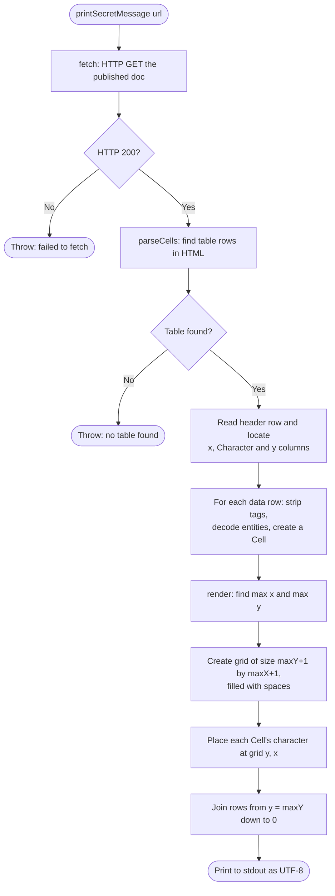

# Secret Message Decoder

Reads a published Google Doc containing a table of Unicode characters and their grid coordinates, rebuilds the grid, and prints it. When viewed in a fixed-width font, the output spells out a secret message in uppercase block letters.

## Usage

Requires Java 16 or later. No external libraries.

```bash
javac SecretMessage.java
java SecretMessage "<published Google Doc URL>"
```

If no URL is given, it falls back to the example document. Programmatically, the entry point is:

```java
SecretMessage.printSecretMessage(String url);
```

## Input format

The document contains a table with three columns:

| x-coordinate | Character | y-coordinate |
|---|---|---|
| 0 | █ | 0 |
| 1 | ▀ | 2 |
| … | … | … |

- Columns are matched by header name, so their order doesn't matter.
- Coordinates start at 0 and have no upper limit.
- Any position without a character is printed as a space.

## Coordinate system

**(0, 0) is the bottom-left corner.** x increases to the right and y increases **upwards**. The grid is therefore printed from the highest y down to 0. Printing from y = 0 first would turn the letters upside down.

```
y=2   █▀▀▀
y=1   █▀▀
y=0   █
      x=0123
```

## Process flow



## Code structure

The work is split into three independent steps, which keeps each one simple and testable on its own:

| Step | Method | Responsibility |
|---|---|---|
| Fetch | `fetch(String url)` | Downloads the document HTML using the JDK's `HttpClient` |
| Parse | `parseCells(String html)` | Extracts the table into a list of `Cell(x, y, character)` records |
| Render | `render(List<Cell> cells)` | Builds the grid and returns it as a multi-line string |

## Design notes

- **Grid cells are `String`s, not `char`s.** Some Unicode characters need two Java `char`s, so a `char` grid could split them.
- **The grid is sized from the data.** It grows to fit the largest coordinates found.
- **Output is forced to UTF-8.** Otherwise block characters can appear as `?` on terminals that use a different default encoding (common on Windows).
- **Parsing uses regular expressions rather than an HTML library.** That avoids external dependencies and is reliable because the document format is fixed. If the format could vary, a proper parser such as jsoup would be a safer choice.
